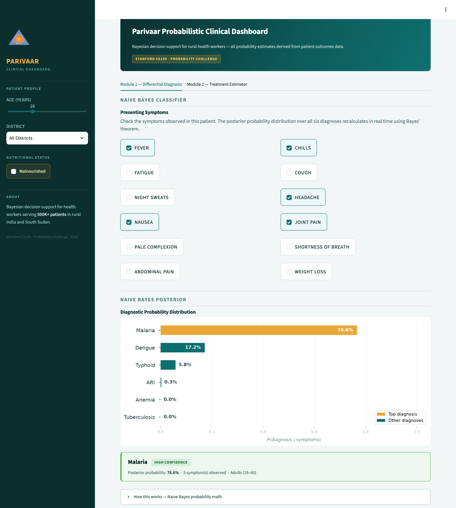
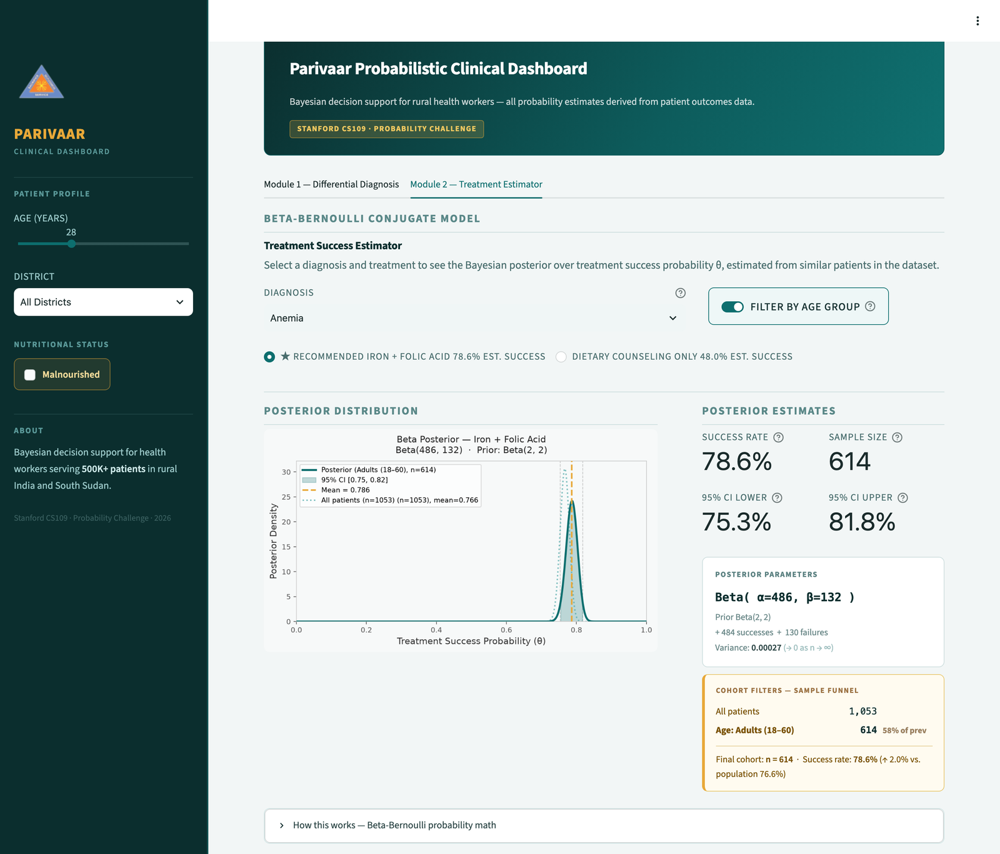
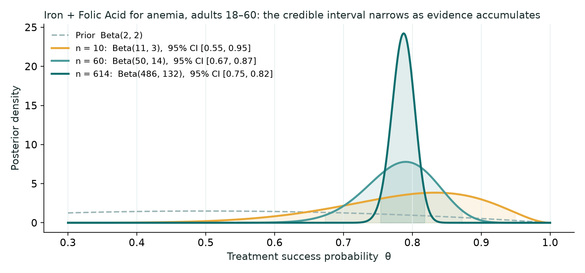

# Parivaar Probabilistic Clinical Dashboard

**Bayesian decision support for rural health workers: given a patient's symptoms, which diagnosis is most likely, and how likely is each treatment to work for someone like them?**

[**▶ Live demo**](https://medical-probability-dashboard.streamlit.app) · Python · NumPy · SciPy · pandas · Streamlit · Matplotlib · built for Stanford CS109's Probability Challenge



---

## Why it exists

Parivaar is a nonprofit that runs free mobile clinics in rural India. When I started working with them in high school, they tracked about 500,000 patients a year with paper, pencil and WhatsApp. I built the [medical-records platform](https://github.com/RyanTellado/MedicalApp-Showcase) that replaced those tally sheets.

This dashboard is the next layer on top of that kind of data. Field staff often work far from a doctor, so the useful question is not just "what does this patient have?" but "how sure should I be, and what has worked for patients like this one?" Every number in the dashboard is a probability with its uncertainty shown, not a single verdict.

> **Data note:** the dashboard runs on **10,000 synthetic patient records** generated by [`generate_data.py`](generate_data.py), modelled on the diagnoses and treatments seen in clinics like Parivaar's. It contains no real patient data and is not clinically validated. It is a prototype of the decision-support layer, not a medical device.

---

## Module 1: Differential diagnosis (Naive Bayes)

Check the symptoms you observe; the posterior over six diagnoses (Malaria, Typhoid, Tuberculosis, Anemia, acute respiratory infection, Dengue) updates instantly.

$$
P(d \mid s_1,\dots,s_{12}) \;\propto\; P(d)\prod_{i=1}^{12} P(s_i \mid d)
$$

- **Learned from data, no sklearn.** Priors and per-symptom likelihoods are maximum-likelihood estimates from the records, with **Laplace smoothing** so an unseen symptom–diagnosis pair never zeroes out a diagnosis.
- **Log-space inference.** The product of twelve likelihoods is computed as a sum of logs and normalised at the end, which avoids floating-point underflow.
- **Patient context.** Likelihoods are learned separately for malnourished and well-nourished patients, because malnutrition itself causes fatigue, pale complexion and weight loss. Age group shifts the log-priors using domain knowledge (respiratory infections and malaria are more common in children, tuberculosis reactivation in the elderly).
- **Confidence, not just a label.** The top diagnosis is reported with its posterior probability and a confidence label, and a "How this works" panel walks through the math.

---

## Module 2: Treatment success estimator (Beta-Bernoulli)

Pick a diagnosis and a treatment. Each past patient's outcome is a Bernoulli trial with unknown success probability θ; with a Beta prior, the posterior has a closed form:

$$
\theta \sim \mathrm{Beta}(2,2), \qquad
\theta \mid s \text{ successes}, f \text{ failures} \;\sim\; \mathrm{Beta}(2+s,\; 2+f)
$$



- **Cohorts like this patient.** Filters for age group, district and nutritional status narrow the data to similar patients; a sample funnel shows how many records survive each filter, so a tiny cohort is visible rather than hidden.
- **Uncertainty you can see.** The full posterior density is plotted with its **95% credible interval**, posterior mean and variance, against the unfiltered population for comparison.
- **Honest about small samples.** With little data the interval stays wide; it tightens only as evidence accumulates:



*Generated from this repo's data: the same Iron + Folic Acid cohort as the screenshot above, using its first 10, first 60, and all 614 records.*

---

## The synthetic data

`generate_data.py` builds the 10,000 records from explicit probability models, seeded for reproducibility:

| Field | Model |
|---|---|
| Age | Gaussian mixture (children, adults, elderly) |
| Diagnosis, district | Multinomial with set prevalences |
| 12 symptoms | Bernoulli, conditioned on diagnosis (malnutrition boosts three of them) |
| Prior visits | Poisson |
| Treatment outcome | Bernoulli with a treatment-specific base success rate |

Because the generating probabilities are known, the dashboard's estimates can be checked against the true values used to create the data.

---

## Run it locally

```bash
git clone https://github.com/RyanTellado/probabilistic-health-dashboard.git
cd probabilistic-health-dashboard
pip install -r requirements.txt
python generate_data.py   # optional: regenerates data/patients.csv
streamlit run app.py
```

```
app.py              Streamlit UI: sidebar patient profile, two module tabs
models.py           NaiveBayesClassifier and BetaBernoulliModel (pure NumPy/SciPy)
generate_data.py    seeded synthetic patient generator
data/patients.csv   10,000 generated records
```

## Limitations

- Naive Bayes assumes symptoms are independent given the diagnosis, which real symptoms are not; the posteriors are useful rankings more than calibrated clinical probabilities.
- The data is synthetic. Before any real use, the models would need fitting and validation on real clinic records, with clinicians in the loop.
- It supports a health worker's judgement; it does not replace a diagnosis.

## Related

- [Mobile Clinic Operations Platform](https://github.com/RyanTellado/MedicalApp-Showcase): the offline-first Android records system for clinics in India and South Sudan that this dashboard builds on.
